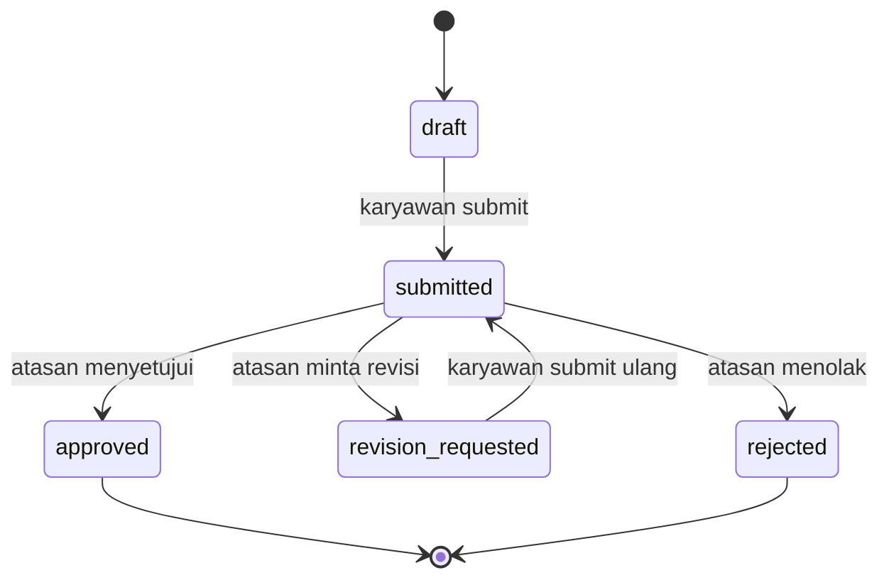

# E-Logbook

Aplikasi pencatatan pekerjaan harian karyawan yang ditinjau dan disetujui atasan.

**Stack:** Laravel 13 (PHP 8.3), Inertia.js + Vue 3 (`<script setup>`, TypeScript), Tailwind CSS 4 + shadcn-vue, PostgreSQL, Pest.

## Dokumentasi

| Dokumen | Isi |
|---|---|
| [docs/prd.md](docs/prd.md) | Product Requirement Document: tujuan, persona, kebutuhan fungsional dan non-fungsional |
| [docs/user-flow.md](docs/user-flow.md) | Alur pengguna per role (login, logbook, review, analitik) dengan diagram |
| [docs/usecase.md](docs/usecase.md) | Aktor, diagram use case, dan skenario |
| [docs/class.md](docs/class.md) | Diagram kelas |
| [BACKEND_STANDARDS.md](BACKEND_STANDARDS.md), [FRONTEND_STANDARTS.md](FRONTEND_STANDARTS.md) | Standar kode backend dan frontend |

## Cara Instalasi

### 1. Prasyarat

| Kebutuhan | Versi / catatan |
|---|---|
| PHP | 8.3 atau lebih baru, dengan ekstensi `pdo_pgsql`, `mbstring`, `xml`, `curl`, `zip`, `intl`, `bcmath` |
| Composer | 2.x |
| Node.js + npm | Node 24 (hanya untuk build frontend) |
| PostgreSQL | 16 (wajib; analitik memakai fitur khusus PostgreSQL) |
| Web server | Nginx atau Apache untuk produksi (`php artisan serve` hanya untuk uji lokal) |

Pengecekan cepat: `php -v`, `php -m | grep -E "pdo_pgsql|intl|mbstring"`, `composer -V`, `node -v`, `psql --version`.

### 2. Ambil kode dan pasang dependensi

```bash
cd e-logbook
composer install --no-dev --optimize-autoloader   # produksi; hilangkan --no-dev dan --optimize-autoloader untuk development
npm install
```

### 3. Siapkan database PostgreSQL

```bash
sudo -u postgres psql <<'SQL'
CREATE USER elogbook WITH PASSWORD 'GANTI_DENGAN_PASSWORD_KUAT';
CREATE DATABASE e_logbook_db OWNER elogbook;
SQL
```

### 4. Konfigurasi `.env`

```bash
cp .env.example .env
php artisan key:generate
```

Lalu ubah nilai berikut di `.env`. Jangan membagikan atau meng-commit file ini.

```dotenv
APP_NAME="E-Logbook"
APP_ENV=production            # local untuk development
APP_DEBUG=false               # true hanya untuk development
APP_URL=https://logbook.contoh.com
APP_LOCALE=id
APP_FALLBACK_LOCALE=id

DB_CONNECTION=pgsql
DB_HOST=127.0.0.1
DB_PORT=5432
DB_DATABASE=e_logbook_db
DB_USERNAME=elogbook
DB_PASSWORD=GANTI_DENGAN_PASSWORD_KUAT

SESSION_DRIVER=database
QUEUE_CONNECTION=database
CACHE_STORE=database

# Notifikasi email (default `log` hanya menulis ke storage/logs)
MAIL_MAILER=smtp
MAIL_HOST=smtp.contoh.com
MAIL_PORT=587
MAIL_USERNAME=...
MAIL_PASSWORD=...
MAIL_FROM_ADDRESS="noreply@contoh.com"
MAIL_FROM_NAME="${APP_NAME}"
```

> Zona waktu aplikasi saat ini `UTC` (`config/app.php`). Pengingat harian dijadwalkan pukul 09:00 dan 17:00 menurut zona waktu tersebut; sesuaikan bila organisasi berada di WIB.

### 5. Migrasi database

```bash
php artisan migrate --force          # struktur tabel saja (produksi)
php artisan migrate:fresh --seed     # development/demo: HAPUS semua data, isi data fiktif
```

Untuk produksi, `DatabaseSeeder` membuat data demo (lihat [Akun demo](#akun-demo)); jangan jalankan di database berisi data nyata. Buat akun nyata lewat `php artisan tinker` atau seeder khusus, dan ganti password akun demo bila seeder pernah dijalankan.

### 6. Build frontend

```bash
npm run build
```

### 7. Jalankan aplikasi

**Development**

```bash
php artisan serve        # http://localhost:8000
npm run dev              # terminal terpisah, hot reload
php artisan queue:work   # terminal terpisah, untuk notifikasi
```

**Produksi**

1. Arahkan document root web server ke folder `public/`.
2. Pastikan `storage/` dan `bootstrap/cache/` dapat ditulis oleh user web server:
   ```bash
   sudo chown -R www-data:www-data storage bootstrap/cache
   sudo chmod -R ug+rwx storage bootstrap/cache
   ```
3. Cache konfigurasi:
   ```bash
   php artisan config:cache && php artisan route:cache && php artisan view:cache
   ```
4. Jalankan queue worker sebagai service (contoh Supervisor `/etc/supervisor/conf.d/elogbook-worker.conf`):
   ```ini
   [program:elogbook-worker]
   command=php /var/www/e-logbook/artisan queue:work --sleep=3 --tries=3 --max-time=3600
   autostart=true
   autorestart=true
   user=www-data
   stopwaitsecs=3600
   ```
5. Tambahkan cron untuk scheduler (pengingat harian `logbook:remind-unsubmitted` dan `logbook:remind-pending-reviews`):
   ```cron
   * * * * * cd /var/www/e-logbook && php artisan schedule:run >> /dev/null 2>&1
   ```
6. Aktifkan HTTPS pada web server.

Contoh Nginx:

```nginx
server {
    listen 80;
    server_name logbook.contoh.com;
    root /var/www/e-logbook/public;
    index index.php;

    location / { try_files $uri $uri/ /index.php?$query_string; }
    location ~ \.php$ {
        include snippets/fastcgi-php.conf;
        fastcgi_pass unix:/run/php/php8.3-fpm.sock;
    }
    location ~ /\.(?!well-known) { deny all; }
}
```

### 8. Verifikasi instalasi

1. Buka `APP_URL`, halaman login tampil.
2. Login dengan akun demo (bila seeder dijalankan), buat logbook, lalu ajukan.
3. Login sebagai supervisor atasannya, logbook muncul di antrean review.
4. (Opsional) `php artisan test` untuk menjalankan test backend.

### 9. Update ke versi baru

```bash
php artisan down
git pull
composer install --no-dev --optimize-autoloader
npm install && npm run build
php artisan migrate --force
php artisan config:cache && php artisan route:cache && php artisan view:cache
php artisan queue:restart
php artisan up
```

### 10. Masalah umum

| Gejala | Penyebab / solusi |
|---|---|
| `could not find driver` | Ekstensi `pdo_pgsql` belum aktif; pasang `php8.3-pgsql` lalu restart PHP-FPM |
| Halaman putih / error 500 | Cek `storage/logs/laravel.log`; pastikan `storage/` dapat ditulis dan `APP_KEY` terisi |
| Tampilan tanpa gaya / `Vite manifest not found` | Jalankan `npm run build` |
| Perubahan `.env` tidak terbaca | Jalankan `php artisan config:clear` (atau `config:cache` ulang) |
| Notifikasi dan pengingat tidak terkirim | Queue worker atau cron scheduler belum berjalan; periksa konfigurasi `MAIL_*` |
| Login diblokir sementara | Rate limit 5 percobaan per menit; tunggu 1 menit |

## Perintah penting

| Tujuan | Perintah |
|---|---|
| Test backend | `php artisan test` |
| Lint PHP | `vendor/bin/pint` (`--test` untuk cek saja) |
| Lint / tipe frontend | `npm run lint` / `npm run typecheck` |
| Test frontend | `npm test` |
| Build frontend | `npm run build` |

> Test backend memakai SQLite in-memory (lihat `phpunit.xml`) sehingga perlu `pdo_sqlite`. Test analitik memakai fitur PostgreSQL dan dilewati bila driver bukan PostgreSQL. Tanpa `pdo_sqlite`, jalankan ke database PostgreSQL **khusus test** (isinya direset): `DB_CONNECTION=pgsql DB_DATABASE=<db_test> php artisan test`.

## Akun demo

Semua password: `password`. Dibuat oleh `DatabaseSeeder` (data fiktif).

| Role | Email |
|---|---|
| Super Admin | `admin@elogbook.test` |
| Manager (kepala departemen) | `manager1@elogbook.test` … `manager3@elogbook.test` |
| Supervisor | `supervisor1@elogbook.test` … `supervisor6@elogbook.test` |
| Karyawan | `employee01@elogbook.test` … `employee30@elogbook.test` |

Hierarki: karyawan → supervisor → manager. Seeder membuat 30 hari kerja terakhir dengan status campuran dan sekitar 10% hari kosong.

## Hak akses

| Role | Logbook sendiri | Review | Analitik |
|---|---|---|---|
| Karyawan | ya | – | – |
| Supervisor | ya | bawahan langsung | – |
| Manager | ya | seluruh hierarki di bawahnya | ya |
| Super Admin | ya | semua | ya |

Tidak ada yang boleh me-review logbook sendiri. Otorisasi memakai `LogbookPolicy`, middleware `role:`, dan Gate `view-analytics` / `export-reports`.

## Alur status logbook



`draft` dan `revision_requested` bisa diedit pemiliknya; `approved` dan `rejected` bersifat final. Setiap transisi dicatat (tidak bisa diubah) di `logbook_status_histories` beserta pelaku dan IP. Aturan transisi ada di `App\Enums\LogbookStatus`.

## Struktur folder

```
app/
  Enums/            UserRole, LogbookStatus, ProgressStatus (string-backed, kolom string di DB)
  Events/           LogbookSubmitted, LogbookReviewed
  Listeners/        pengirim notifikasi
  Notifications/    database + email (antrean)
  Console/Commands/ pengingat harian
  Http/Controllers/ Logbook, Review, Analytics, Notification
  Http/Requests/    validasi (Form Request, pesan Indonesia)
  Http/Resources/   bentuk props Inertia (bukan model utuh)
  Models/ Policies/ Services/   LogbookService (satu-satunya jalur transisi), AnalyticsService
database/           migrations, factories, seeders
resources/js/
  pages/            halaman Inertia: Logbooks, Reviews, Analytics
  components/       ui (shadcn-vue), logbook, review, analytics, notification
  layouts/ lib/ composables/ types/
src/                frontend lama, tidak dipakai build (belum dihapus)
tests/              Pest: Unit dan Feature
```

## Catatan keamanan dan performa

- Semua route bisnis di dalam group `auth`; akses data selalu lewat policy, jadi mengganti ID di URL menghasilkan 403.
- Kolom sensitif `Logbook` (status, penyetuju, total) tidak mass-assignable; hanya `LogbookService` yang mengubahnya.
- Rate limit: login 5/menit; aksi review 60/menit; bulk approve 10/menit.
- `Model::preventLazyLoading` aktif di luar produksi agar N+1 terdeteksi.
- Agregasi analitik dikerjakan PostgreSQL dan di-cache 10 menit (dibersihkan setiap transisi status).

## Batasan saat ini

- Fitur export belum dibuat (Gate `export-reports` sudah ada, route belum).
- Belum ada UI pengelolaan pengguna, departemen, dan proyek; data dibuat lewat seeder.
- Belum ada role HR terpisah; analitik hanya untuk Manager dan Super Admin.
- Belum ada layar pengelolaan hari libur (tabel `holidays` dipakai analitik).
