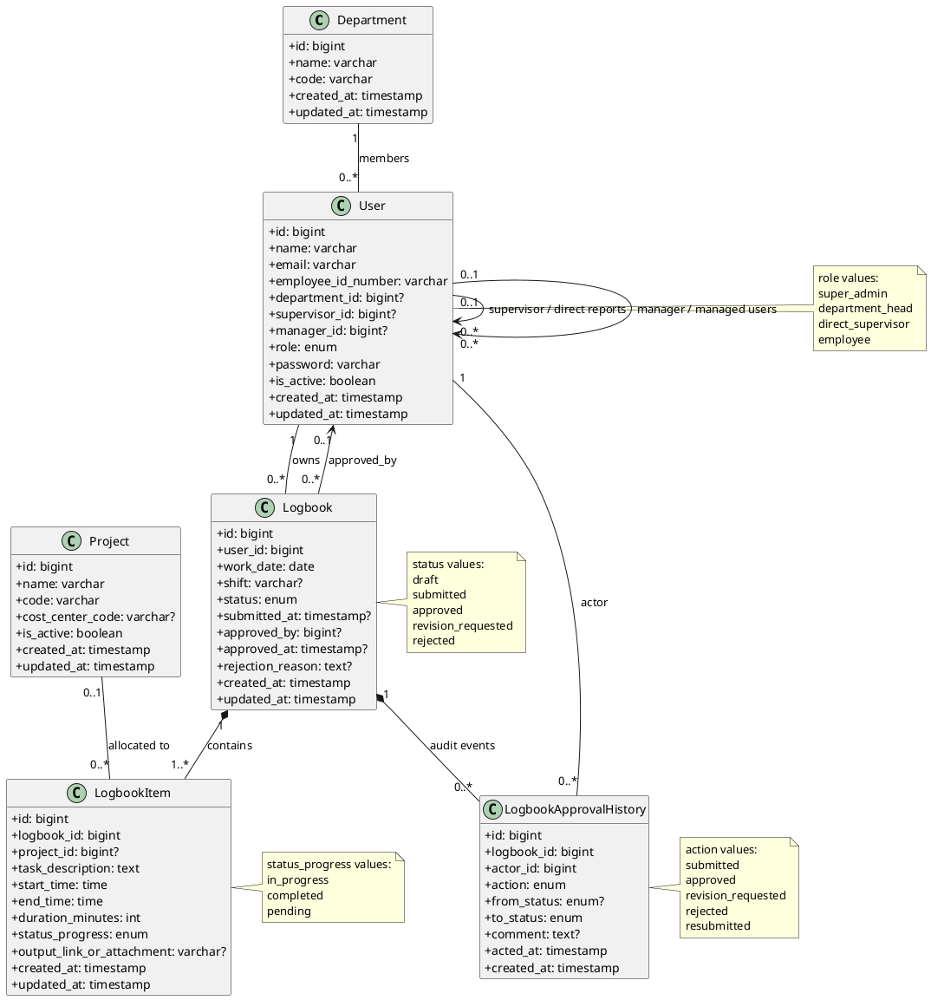

# Domain Class Diagram dan ERD

## 1. Catatan Model

- `User.supervisor_id` menunjukkan atasan langsung. `manager_id` dapat merepresentasikan relasi ke manager/kepala departemen bila organisasi membutuhkan relasi skip-level eksplisit.
- `Project` dapat dikembangkan menjadi `CostCenter` atau dipecah menjadi dua entitas apabila kode alokasi biaya berbeda dari proyek.
- `LogbookApprovalHistory` menyimpan jejak setiap transisi status dan komentar. Keputusan terbaru juga tercermin pada `Logbook.status`.
- Relasi User–Project tidak dimodelkan sebagai many-to-many pada rancangan minimum. Jika akses proyek harus dibatasi per tim, tambahkan tabel pivot seperti `project_user` atau `department_project`.

## 2. PlantUML Class Diagram

## 3. Kardinalitas

| Relasi | Kardinalitas | Makna |
|---|---|---|
| Department → User | 1-to-N | Satu departemen memiliki banyak pengguna; pengguna dapat belum memiliki departemen saat proses penempatan. |
| User → User melalui `supervisor_id` | 1-to-N | Satu supervisor memiliki banyak direct report; setiap pengguna paling banyak memiliki satu supervisor langsung. |
| User → User melalui `manager_id` | 1-to-N | Satu manager dapat mengelola banyak pengguna. |
| User → Logbook | 1-to-N | Satu pengguna memiliki banyak logbook; setiap logbook memiliki satu pemilik. |
| User → Logbook melalui `approved_by` | 1-to-N | Satu approver dapat menyetujui banyak logbook; logbook belum tentu telah disetujui. |
| Logbook → LogbookItem | 1-to-N | Satu logbook memiliki satu atau lebih item aktivitas setelah dikirim. |
| Project → LogbookItem | 1-to-N | Satu proyek dapat dipakai banyak item; item dapat tidak dialokasikan ke proyek. |
| Logbook → LogbookApprovalHistory | 1-to-N | Satu logbook memiliki banyak catatan perubahan status dan keputusan. |
| User → LogbookApprovalHistory | 1-to-N | Satu pengguna dapat menjadi aktor pada banyak peristiwa audit. |
| User ↔ Project (opsional) | N-to-N | Jika akses proyek dibatasi per pengguna, gunakan pivot `project_user`. |

## 4. Rekomendasi Constraint dan Indeks

- `users.email`, `users.employee_id_number`, `departments.code`, dan `projects.code` unik.
- Indeks logbook pada `(user_id, work_date)`, `(status, work_date)`, serta jalur supervisor/departemen untuk antrean review.
- Gunakan unique constraint `(user_id, work_date, shift)` jika karyawan dapat memiliki beberapa logbook per hari. Jika hanya satu logbook harian, gunakan `(user_id, work_date)`.
- `duration_minutes` harus positif dan konsisten dengan rentang waktu; validasi aplikasi dan constraint database dapat menegakkan aturan tersebut.
- `LogbookApprovalHistory` sebaiknya append-only untuk menjaga integritas audit.
- Untuk multi-level approval mendatang, pertimbangkan `approval_steps` atau `approval_assignments` alih-alih menambah kolom approver berulang pada `logbooks`.
