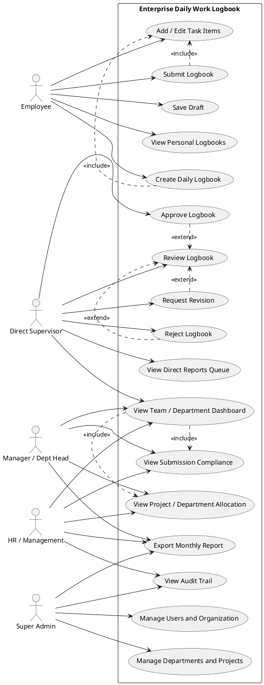

# Use Case Specification

## 1. Aktor

- **Employee:** mengelola dan mengirim logbook pribadi.
- **Direct Supervisor:** meninjau logbook bawahan langsung.
- **Manager / Dept Head:** memantau dan meninjau data di lingkup departemennya.
- **HR / Management:** memantau kepatuhan dan mengekspor laporan.
- **Super Admin:** mengelola pengguna, struktur organisasi, konfigurasi, dan akses sistem.

## 2. Use Case Diagram

## 3. Skenario: Create / Submit Daily Logbook

**Aktor utama:** Employee

**Prasyarat:** Employee sudah login dan berstatus aktif serta memiliki akses ke fitur logbook.

### Alur utama

1. Employee membuka form logbook untuk tanggal kerja.
2. Sistem memuat draft yang sudah ada untuk tanggal tersebut, jika tersedia.
3. Employee mengisi shift opsional dan satu atau lebih item aktivitas.
4. Employee dapat memilih proyek/cost center dan mengisi jam mulai, selesai, progres, serta output.
5. Employee menyimpan sebagai draft.
6. Sistem memvalidasi input dan menyimpan logbook beserta item-itemnya.
7. Employee memilih **Submit**.
8. Sistem memvalidasi kelengkapan dan konsistensi waktu/durasi.
9. Sistem mengubah status menjadi `submitted`, mencatat waktu pengiriman, dan memberi notifikasi kepada supervisor.
10. Logbook muncul di antrean review atasan yang berwenang.

### Alur alternatif

- Jika validasi gagal, sistem menampilkan kesalahan pada field terkait dan tidak mengubah status.
- Selama status masih draft, employee dapat mengedit atau menghapus item.
- Jika tanggal tersebut sudah memiliki logbook, sistem membuka logbook yang ada agar tidak tercipta duplikat.

**Pasca-kondisi:** Logbook tersimpan sebagai `submitted` dan tercatat di antrean review.

## 4. Skenario: Supervisor Review & Approval / Revision

**Aktor utama:** Direct Supervisor

**Prasyarat:** Supervisor sudah login; logbook berstatus `submitted`; pemilik logbook adalah bawahan langsung atau berada dalam lingkup kewenangannya.

### Alur utama

1. Supervisor membuka antrean review.
2. Sistem menampilkan logbook bawahan berstatus `submitted`.
3. Supervisor memfilter berdasarkan karyawan atau tanggal.
4. Supervisor membuka logbook dan memeriksa ringkasan serta item aktivitas.
5. Supervisor memilih tindakan:
   - **Approve:** sistem menyimpan status `approved`, `approved_by`, dan `approved_at`.
   - **Request Revision:** supervisor memasukkan catatan dan sistem menyimpan status `revision_requested`.
   - **Reject:** supervisor memasukkan alasan dan sistem menyimpan status `rejected`.
6. Sistem menambahkan entri audit trail berisi aktor, tindakan, komentar, status sebelumnya, dan status baru.
7. Sistem memberi notifikasi kepada employee.

### Alur alternatif

- Jika supervisor tidak berwenang, server menolak permintaan tanpa mengubah data.
- Jika catatan revisi atau alasan penolakan tidak diberikan, validasi menolak tindakan.
- Jika status telah berubah setelah halaman dibuka, sistem meminta supervisor memuat ulang untuk mencegah keputusan menimpa data terbaru.

**Pasca-kondisi:** Keputusan tersimpan dan dapat ditelusuri melalui audit trail.

## 5. Skenario: HR Monitoring / Report Export

**Aktor utama:** HR / Management

**Prasyarat:** Pengguna memiliki izin melihat laporan dan filter berada dalam lingkup aksesnya.

### Alur utama

1. HR membuka dashboard laporan dan memilih periode.
2. HR memfilter departemen, karyawan, proyek, atau status.
3. Sistem menghitung kepatuhan pengiriman, status review, dan alokasi durasi.
4. HR meninjau hasil pada dashboard.
5. HR memilih ekspor Excel atau PDF.
6. Sistem memvalidasi izin dan filter, kemudian membuat file laporan.
7. Untuk laporan besar, sistem memproses ekspor melalui queue dan memberi tahu HR saat file siap.
8. HR mengunduh file melalui tautan yang berlaku terbatas.

### Alur alternatif

- Jika hasil kosong, dashboard menampilkan keadaan tanpa data dan ekspor dinonaktifkan atau menghasilkan laporan kosong.
- Jika permintaan ekspor terlalu besar, sistem menjadwalkan pemrosesan asynchronous.
- Jika filter mencakup data di luar izin, sistem menolak permintaan atau membatasi hasil ke lingkup pengguna.

**Pasca-kondisi:** Laporan tersedia dan tindakan ekspor tercatat sesuai kebijakan audit.
