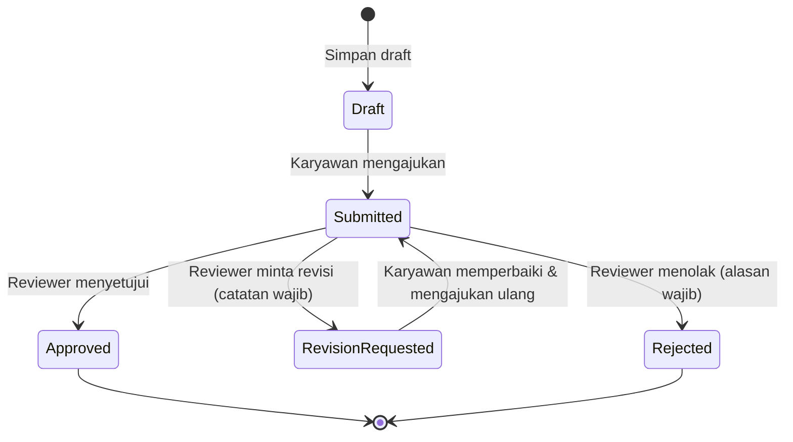
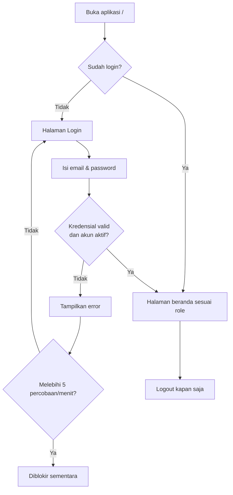
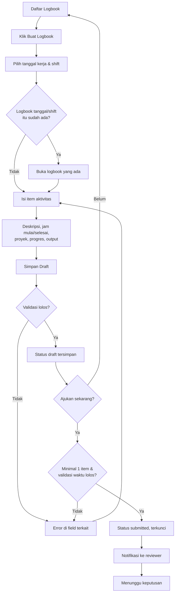
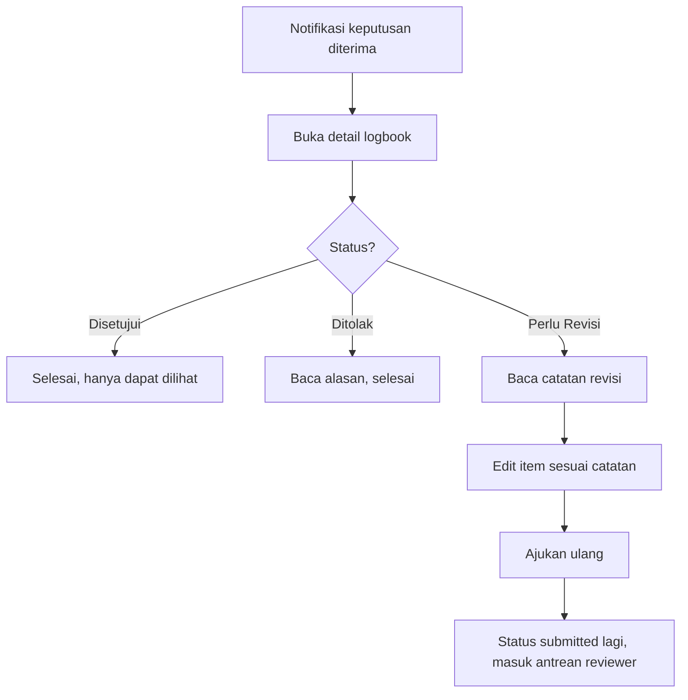
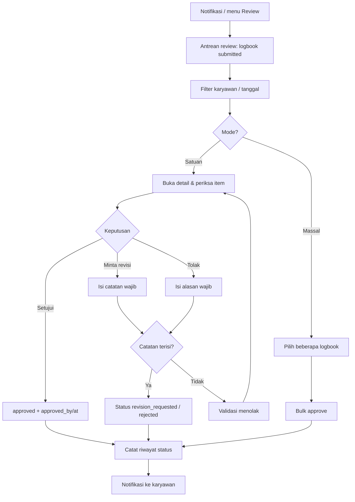
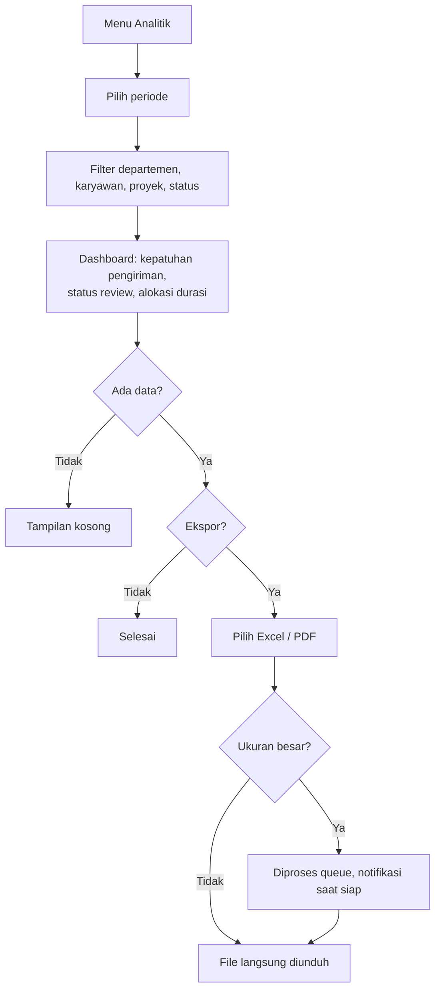

# Dokumentasi User Flow

Dokumen ini menggambarkan alur pengguna per role berdasarkan PRD ([prd.md](prd.md)), use case ([usecase.md](usecase.md)), serta route, policy, dan service yang ada di kode. Diagram memakai Mermaid.

## 1. Peta Halaman dan Akses

| Halaman | Route | Akses |
|---|---|---|
| Login | `/login` | Tamu (rate limit 5 percobaan/menit) |
| Daftar logbook | `/logbooks` | Semua role (data sendiri) |
| Form logbook (buat/ubah) | `/logbooks/create`, `/logbooks/{id}/edit` | Pemilik, status `draft` atau `revision_requested` |
| Detail logbook | `/logbooks/{id}` | Pemilik, atasan langsung, manager di atas hierarki, super admin |
| Antrean review | `/reviews` | Supervisor, Manager, Super Admin |
| Detail review | `/reviews/{id}` | Reviewer yang berwenang, status `submitted` |
| Analitik | `/analytics` | Manager, Super Admin |
| Notifikasi | `/notifications/*` | Semua role yang login |

Pembatasan akses diterapkan di server (middleware `role`, Gate, dan `LogbookPolicy`), bukan hanya dengan menyembunyikan menu.

## 2. Status Logbook

| Status | Label UI | Bisa diedit pemilik | Final |
|---|---|:-:|:-:|
| `draft` | Draft | Ya | Tidak |
| `submitted` | Diajukan | Tidak (terkunci) | Tidak |
| `revision_requested` | Perlu Revisi | Ya | Tidak |
| `approved` | Disetujui | Tidak | Ya |
| `rejected` | Ditolak | Tidak | Ya |

Setiap transisi dicatat di riwayat status (aktor, status lama/baru, catatan, waktu).

## 3. Alur Umum: Login

## 4. Alur Karyawan: Membuat dan Mengajukan Logbook

Aturan validasi yang berlaku saat simpan/ajukan:

- Tanggal kerja tidak boleh di masa depan.
- Satu logbook per kombinasi tanggal dan shift per karyawan.
- Jam selesai harus berbeda dari jam mulai.
- Rentang jam antar item tidak boleh tumpang tindih.
- Total durasi dalam satu hari maksimal 24 jam.
- Pengajuan membutuhkan minimal satu item.

## 5. Alur Karyawan: Menindaklanjuti Hasil Review

## 6. Alur Reviewer (Supervisor / Manager / Super Admin)

Cakupan data: Supervisor hanya bawahan langsung; Manager hanya karyawan di bawah hierarkinya; Super Admin semua. Reviewer tidak dapat meninjau logbook miliknya sendiri.

Kasus tepi:

- Status sudah berubah sejak halaman dibuka: aksi ditolak karena transisi tidak valid; reviewer memuat ulang.
- Reviewer tidak berwenang: server menolak (403) tanpa mengubah data.
- Aksi review dibatasi rate limit; bulk approve punya batas lebih ketat.

## 7. Alur Manager / Super Admin: Analitik dan Ekspor

Catatan: Gate `export-reports` sudah ada, tetapi route ekspor belum terpasang; alur ekspor di atas adalah target PRD.

## 8. Alur Notifikasi

| Pemicu | Penerima |
|---|---|
| Logbook diajukan | Reviewer berwenang |
| Disetujui / diminta revisi / ditolak | Pemilik logbook |

Pengguna dapat menandai satu notifikasi atau semuanya sebagai sudah dibaca.

## 9. Ringkasan Perjalanan per Role

| Role | Perjalanan utama |
|---|---|
| Karyawan | Login → buat/isi logbook harian → simpan draft → ajukan → pantau status → revisi bila diminta |
| Supervisor | Login → antrean review bawahan langsung → periksa → setujui/revisi/tolak; tetap mengisi logbook sendiri |
| Manager | Seperti Supervisor untuk cakupan hierarkinya, ditambah analitik departemen dan ekspor |
| Super Admin | Akses review dan analitik penuh; pengelolaan pengguna/organisasi (belum ada UI) |
